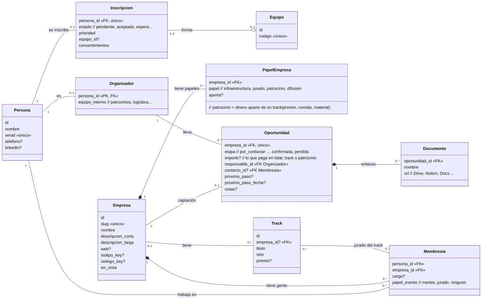

# Modelo de datos · personas, empresas y tracks

Propuesta del 24 nov 2026. Amplía el apartado 1.3 de `docs/plan-implementacion.md`, que solo tenía empresas, papeles y tracks. La pantalla que lo usa está en el canvas, en el tablero «Panel de organización» (`Admin.dc.html`).

## Ideas de partida

1. **Una persona es una sola fila**, haga lo que haga: participante, organizadora o miembro de una empresa. Si alguien de Kapia también se inscribe, es la misma persona con dos relaciones.
2. **La empresa existe sin track.** Puede dar infraestructura (créditos de API, cuentas), ser jurado, patrocinar o hacer difusión. Tener un track es una relación más: **la empresa tiene el track**, no al revés.
3. **Las personas forman parte de la empresa** a través de una membresía, que dice qué hacen en el evento: mentora, jurado o nada.
4. **La captación** (el embudo de contacto con empresas que gestiona Álvaro) es una oportunidad por empresa. En el admin, empresa y captación son **una sola ficha**: datos públicos, logos, papeles y captación (estado, importe, contacto, responsable, próximo paso, notas y documentos).
5. **Sin orden.** Todas las empresas pagan lo mismo, así que ni los tracks ni la cinta de logos tienen orden: la web los baraja en cada visita. No hay columna `orden`.

## Diagrama

### Composición y agregación

- **Composición** (rombo lleno): los papeles y las membresías no existen sin su empresa. Borrar la empresa los borra (`ON DELETE CASCADE`).
- **Agregación** (rombo vacío): las inscripciones forman un equipo, pero existen sin él. Si el equipo se disuelve, cada inscripción sigue y pierde su `equipo_id`.
- **Asociación simple:** la persona existe por sí misma. Borrar una empresa borra su membresía, no a la persona. Un track sobrevive a su empresa (`ON DELETE SET NULL`) y en la web vuelve a salir «por anunciar».

## Qué contiene cada cosa

| Entidad | Qué guarda | Notas |
|---|---|---|
| Persona | Nombre, email, teléfono y LinkedIn opcionales | El email es la clave para el enlace mágico. Una fila por humano |
| Organizador | Equipo interno de la organización | Quién entra en `/admin`. Hoy lo decide Cloudflare Access por email; esta fila sirve para asignar responsables en la captación (en el prototipo están fijos en el código) |
| Inscripción | Estado, prioridad, datos del formulario y consentimientos | La de `0003_inscripcion.sql`, con `persona_id` en lugar de `email` |
| Equipo | Código para unirse | De 1 a 4 inscripciones |
| Empresa | Ficha pública y **dos logos** | Isotipo: el cuadro del track. Isologo: la columna del track, la cinta, acreditaciones, documentos y correos. Con sus colores originales. Van a R2 |
| PapelEmpresa | Lo que aporta, además de un track | Lista abierta en código (`PAPELES`); un papel nuevo no necesita migración. `aporta` es una nota interna («créditos de API») |
| Membresía | Qué hace esa persona por la empresa en el evento | Mentor, jurado o ninguno. El cargo es informativo («Talent Acquisition») |
| Track | El reto que se publica | La empresa pone nombre, etiqueta y logo; el track solo pone título, reto y premio. El track se asigna desde la pestaña Tracks, no desde la captación |
| Oportunidad | Estado, importe, responsable, contacto, próximo paso con fecha y notas | Lo lleva Álvaro en su herramienta. El contacto es una membresía (persona de la empresa con cargo) |
| Documento | Nombre y enlace | Dosieres, acuerdos, enunciados de reto, facturas. Solo enlaces, no ficheros |

## Reglas

- **Orden al azar:** la landing baraja los tracks y la cinta en cada petición (la página ya es dinámica). Los numerales 01–06 son la posición en pantalla, no un dato.
- Una empresa tiene **como mucho un track** por ahora (pregunta abierta 8 del plan). El modelo admite varios; si hacen falta, la landing los agrupa.
- Una persona puede ser **jurado de varios tracks**, pero no del de su propia empresa.
- **Solo una empresa confirmada puede tener track.** El selector del track no ofrece las que están en conversación, para no anunciar en la web un patrocinador que todavía no lo es.
- **Dos maneras de guardar.** Lo que se ve en la web (ficha pública, logos, cinta, tracks, evento y preguntas) espera a «Publicar cambios». Lo interno (captación, papeles, «qué aporta» y personas) se guarda solo.
- **Borrar una empresa** borra su captación, sus documentos y sus membresías, y pide confirmación. Si ya hubo conversaciones, lo normal es marcarla como «perdida».
- **Logos:** se pintan tal cual, sin teñir.
- **En la web** salen las empresas con track (en su columna) y las que tienen `en_cinta` e isologo (en la cinta). El resto solo se ve en el admin.
- Las **personas de empresa no entran en la preinscripción ni en la inscripción.** Su acceso (check-in, acreditación) sale de la membresía.
- **RGPD:** las personas de empresa son datos de terceros. Se guarda nombre, email de trabajo y cargo; teléfono y LinkedIn solo de la persona de contacto de la captación, que es quien los facilita para eso. Todo se borra con el resto al terminar el evento (decisión 7 del plan), salvo lo que haya que conservar por facturación.

## Cómo encaja con lo que ya hay

- `event_content.retos` (PR L.2, ya hecho) guarda hoy empresa y track juntos en el JSON. Con este modelo pasa a las tablas `companies`, `company_roles`, `memberships` y `tracks`. La migración copia los datos del JSON una vez.
- `waitlist` se queda como está. La prioridad se calcula cruzando su email con `Persona.email`.
- La captación vive en la herramienta de Álvaro (otro Worker con su propia base de datos). Si se integra en el admin, su tabla de oportunidades apunta a `companies.id` y no duplica la empresa.
